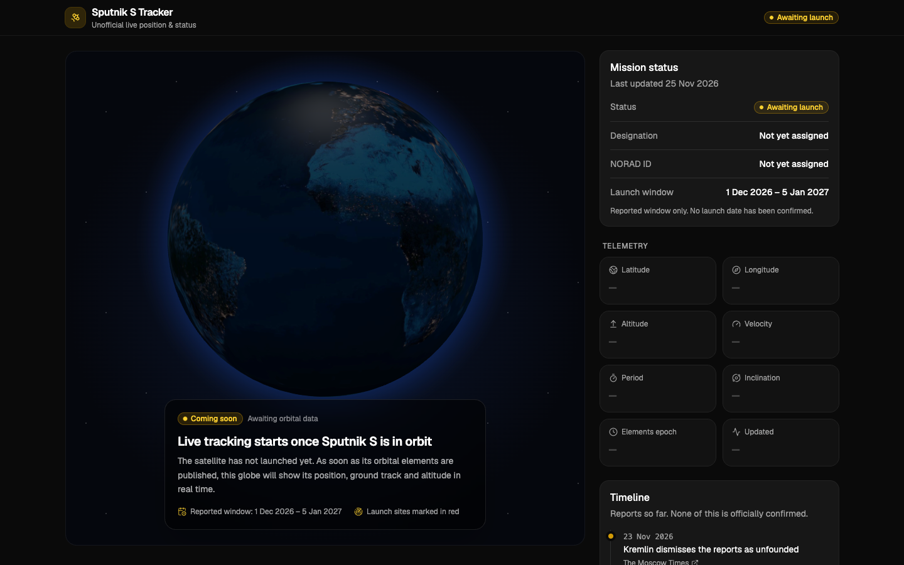
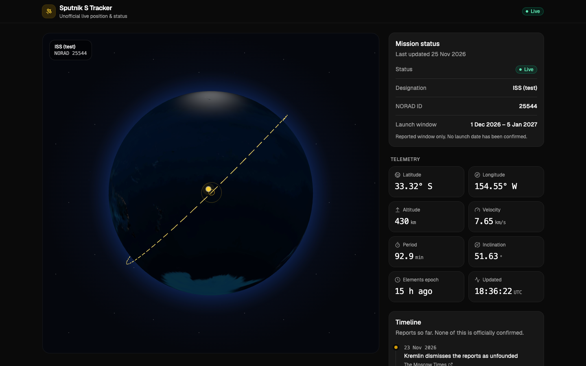

<div align="center">

# 🛰️ Sputnik S Tracker

**An open-source page that tracks the status and live position of the reported Russian satellite Sputnik S on a 3D globe.**

[](https://github.com/mroxso/sputnik-s-tracker/actions/workflows/deploy.yml)
[](LICENSE)
[](CONTRIBUTING.md)

[**Live site →**](https://mroxso.github.io/sputnik-s-tracker/)

</div>



## About

According to media reports from November 2026, Russia may launch a satellite called *Sputnik S* in a window starting December 2026. None of this is officially confirmed, and the Kremlin denies the reports.

This project answers one question: **is it up there yet, and where is it right now?**

- **Before launch**, the page shows a *coming soon* banner, the reported launch window, the likely launch sites (Plesetsk, Baikonur) and a sourced timeline of reports.
- **After launch**, once the satellite has a public catalog entry, the page shows its live position, its orbit at the correct altitude, and telemetry such as altitude, velocity, period and inclination.

The site is fully static. Everything is computed in the visitor's browser, with no backend and no API keys.

> [!NOTE]
> This is an independent, community-run project. It is not affiliated with any government, military or space agency. Positions are estimates computed from public orbital elements.

## Features

- 🌍 Interactive 3D globe (drag to rotate, scroll or pinch to zoom)
- 📡 Live position updated every second, using SGP4 propagation of public TLE data
- 🛤️ Orbit trace drawn at the satellite's real altitude
- 📊 Telemetry: latitude, longitude, altitude, velocity, period, inclination and orbital-data age
- 🗓️ Sourced timeline of reports
- 📱 Responsive layout for phone and desktop, dark theme
- ✏️ Data-driven: mission status lives in one JSON file that anyone can update via PR


<sub>Live mode, tested with the ISS (NORAD 25544) as a stand-in.</sub>

## How it works

```
public/data/sputnik-s.json ──► mission status, launch window, timeline, NORAD ID
                                   │
                                   ▼ (once noradId is set)
CelesTrak GP API ──► TLE ──► satellite.js (SGP4) ──► position every 1 s ──► react-globe.gl
```

| Part | Technology |
| --- | --- |
| App | [Vite](https://vite.dev), React 19, TypeScript |
| UI | [Tailwind CSS v4](https://tailwindcss.com), [shadcn/ui](https://ui.shadcn.com), [Lucide](https://lucide.dev) icons |
| Globe | [react-globe.gl](https://github.com/vasturiano/react-globe.gl) (three.js), lazy-loaded |
| Orbit math | [satellite.js](https://github.com/shashwatak/satellite-js) |
| Orbital data | [CelesTrak](https://celestrak.org) (supports cross-origin browser requests, no key needed) |
| Hosting | GitHub Pages via GitHub Actions |

## Updating the mission data

All mission info lives in [`public/data/sputnik-s.json`](public/data/sputnik-s.json). Open pages re-read it every 10 minutes, so a merged PR is all it takes.

When the satellite is catalogued (it will most likely be named `Kosmos-XXXX`), set:

```json
{
  "status": "tracking",
  "noradId": 12345,
  "designation": "Kosmos-XXXX"
}
```

The page then pulls fresh orbital elements from CelesTrak every 2 hours. If CelesTrak has no data, you can paste elements by hand with `"tle": ["1 …", "2 …"]`.

| Field | Meaning |
| --- | --- |
| `status` | `awaiting-launch`, `launched`, `tracking` or `decayed` |
| `noradId` | NORAD catalog number, or `null` before launch |
| `designation` | Official name once known |
| `launchWindow` | `{ start, end, note }`, shown while waiting |
| `launchSites` | Markers on the globe before launch |
| `timeline` | `{ date, title, source: { label, url } }` entries; every entry needs a source |
| `tle` | Optional manual two-line element set |

Have news, a launch confirmation or the NORAD ID? [Open a mission update issue](https://github.com/mroxso/sputnik-s-tracker/issues/new?template=mission-update.yml) or send a PR.

## Development

Requires Node.js 20.19+ or 22.12+.

```bash
git clone https://github.com/mroxso/sputnik-s-tracker.git
cd sputnik-s-tracker
npm install
npm run dev        # http://localhost:5173
npm run lint
npm run build      # outputs to dist/
```

To try live mode locally, set `noradId` in `public/data/sputnik-s.json` to any active satellite, for example `25544` (ISS). Don't commit that change.

### Project structure

```
src/
  App.tsx                     page layout
  components/
    satellite-globe.tsx       3D globe (react-globe.gl)
    coming-soon-banner.tsx    pre-launch banner
    telemetry.tsx             telemetry cards
    timeline.tsx              report timeline
    ui/                       shadcn/ui components
  hooks/
    use-mission.ts            loads sputnik-s.json
    use-satellite.ts          fetches TLE, propagates position
  lib/orbit.ts                SGP4 helpers, CelesTrak fetch
public/
  data/sputnik-s.json         mission data
  textures/                   globe textures
```

## Deployment

[`.github/workflows/deploy.yml`](.github/workflows/deploy.yml) builds and lints every PR and deploys `main` to GitHub Pages.

To deploy a fork: **Settings → Pages → Build and deployment → Source: GitHub Actions**. The workflow sets the base path from the repository name, so it works under any repo name.

## Contributing

Contributions are welcome: code, design, translations, and especially **sourced mission updates**. See [CONTRIBUTING.md](CONTRIBUTING.md) and our [Code of Conduct](CODE_OF_CONDUCT.md).

## Credits

- Earth textures and topology from [three-globe](https://github.com/vasturiano/three-globe) (MIT), based on NASA imagery
- Orbital elements courtesy of [CelesTrak](https://celestrak.org) / Dr. T.S. Kelso, from data published by the U.S. Space Force
- Built with [react-globe.gl](https://github.com/vasturiano/react-globe.gl), [satellite.js](https://github.com/shashwatak/satellite-js) and [shadcn/ui](https://ui.shadcn.com)

## License

[MIT](LICENSE)
